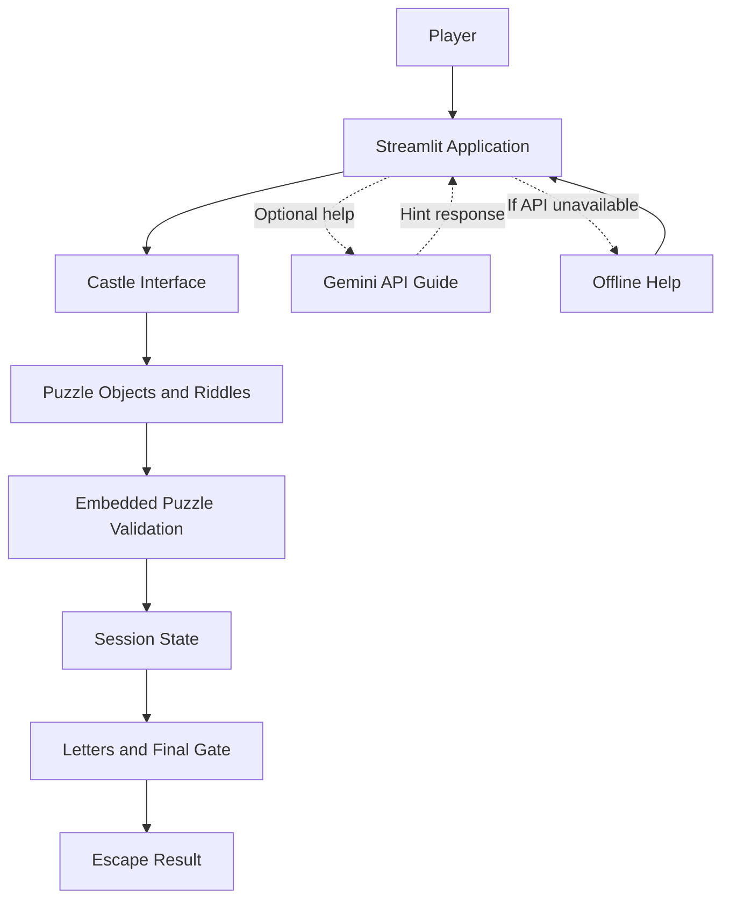

# Version 1 – System Architecture

Version 1 uses a simple architecture. The Streamlit application
handles the interface, session state and puzzle validation.

## Explanation

1. The player interacts with the Streamlit application.
2. The application displays the castle and puzzle objects.
3. The player submits answers to the riddles.
4. Puzzle validation is handled inside the application.
5. Session state stores the player's progress.
6. The final gate checks the collected letters.
7. An optional Gemini guide provides additional help.
