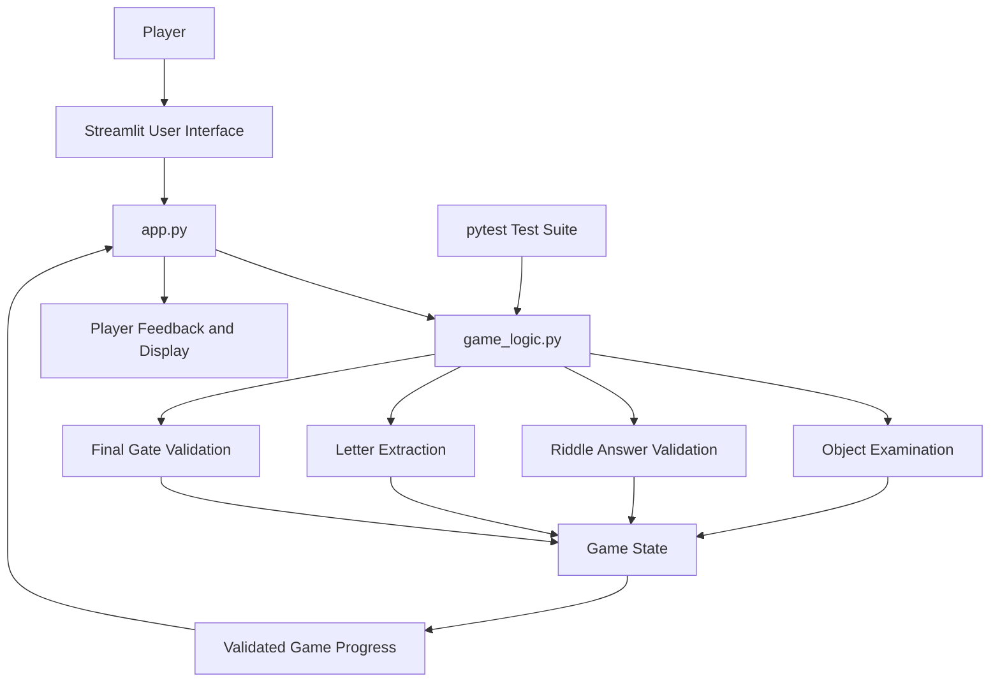

# Version 2 – System Architecture

Version 2 separates the user interface from the game logic.
This makes the application more modular and easier to test.

## Explanation

1. The player interacts with the Streamlit interface.
2. `app.py` receives the player's input.
3. `game_logic.py` validates the requested action.
4. The game logic updates the game state when appropriate.
5. The interface displays the updated progress and feedback.
6. The pytest test suite independently checks the game logic.

## Main improvement

Unlike Version 1, Version 2 does not keep all puzzle
validation inside the interface.

The separate game logic module improves modularity,
testability and maintainability.
